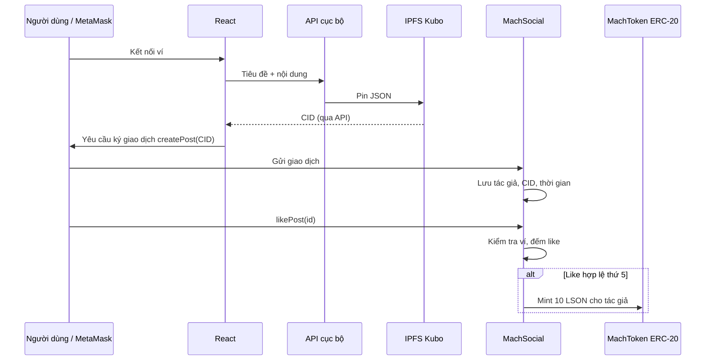

# Lson — mạng xã hội phi tập trung

Đồ án React + Solidity + Hardhat + IPFS, gồm đúng 3 trang: trang chủ, đăng bài và trang cá nhân. Người dùng kết nối MetaMask, đăng bài lên IPFS, like trên blockchain và nhận **10 LSON thử nghiệm khi bài đạt 5 like hợp lệ**.

## Chạy demo nhanh

**Trên máy Windows này**, đã chuẩn bị Node riêng trong `.tools/node/` và cài thư viện dự án. Trong terminal VS Code đang mở thư mục `mach`, chỉ cần chạy:

```powershell
.\start-demo.cmd
```

Lệnh này không cần `node`, `npm` hoặc `pnpm` nằm trong PATH của VS Code. Để xem tài khoản thử nghiệm, mở terminal khác và chạy `.\start-demo.cmd accounts`. Giữ terminal demo mở; chờ thông báo **Lson sẵn sàng** rồi truy cập **http://127.0.0.1:3001**. Nếu chuyển dự án sang máy khác mà không mang theo `.tools/` và `node_modules/`, làm theo hướng dẫn cài đặt bên dưới.

Yêu cầu: **Node.js 24 LTS**, **pnpm 11**, trình duyệt Chrome/Edge có MetaMask. Đã kiểm tra với Node 24.22.1. Nếu chưa có pnpm, cài bằng `npm install -g pnpm@11.25.0`.

Mở terminal tại thư mục chứa `package.json`:

```powershell
pnpm install
pnpm demo
```

Mở **http://127.0.0.1:3001** bằng trình duyệt có MetaMask. Giữ terminal đang chạy. `Ctrl+C` dừng các dịch vụ do lệnh demo tạo.

Lần đầu cần internet để tải thư viện và Kubo 0.39.0. Script lấy Kubo từ bản phát hành chính thức `github.com/ipfs/kubo`, xác minh SHA-512 và giải nén vào `.tools/`. Không cần Docker, API key hoặc dịch vụ pinning trả phí. Nếu phần mềm bảo mật chặn tải hoặc chạy tệp, cài Kubo thủ công từ nguồn chính thức; không tắt phần mềm bảo mật để chạy dự án.

`pnpm demo` biên dịch giao diện, chạy Kubo + Hardhat + API, triển khai hợp đồng và thêm 3 bài thật vào IPFS/blockchain. Mỗi lần chạy lại tạo một blockchain Hardhat mới và triển khai lại hợp đồng. Dữ liệu blockchain phiên trước không được giữ; tệp IPFS vẫn được pin trong `.ipfs/`. Không dùng chế độ này cho dữ liệu cần giữ lâu dài.

## Kết nối MetaMask

Khi đã kết nối, bấm địa chỉ ví ở góc trên phải để mở quản lý ví. Chọn **Đổi ví trong MetaMask**, chọn tài khoản muốn dùng và cấp quyền cho Lson. Mỗi tài khoản phải được cấp quyền riêng; chọn một ví có nhãn **Chưa kết nối** trong MetaMask chưa làm website chuyển sang ví đó. Trang cá nhân cũng có nút **Đổi ví** và **Ngắt kết nối**. Đăng xuất xóa phiên trên Lson, yêu cầu MetaMask thu hồi quyền và được ghi nhớ khi tải lại trang. Bài viết và token vẫn thuộc địa chỉ ví cũ.

1. Bấm **Kết nối ví** trên website.
2. Bấm **Chuyển mạng** nếu ví đang ở mạng khác. Hoặc thêm mạng thủ công:

   | Trường | Giá trị |
   | --- | --- |
   | Tên mạng | Hardhat Local |
   | RPC URL | `http://127.0.0.1:8545` |
   | Chain ID | `31337` |
   | Ký hiệu tiền | `ETH` |

3. Mở terminal khác tại thư mục dự án, chạy `pnpm accounts` để xem 6 tài khoản Hardhat và khóa thử nghiệm. Nhập tài khoản bằng chức năng **Import account / Private key** trong MetaMask. Chọn tài khoản vừa nhập và cấp quyền kết nối cho website.
4. Những tài khoản này đã có ETH cục bộ để trả phí gas. **Đây là khóa thử nghiệm công khai; tuyệt đối không chuyển tiền thật vào các tài khoản này hoặc dùng chúng trên mainnet.**

Website chỉ yêu cầu địa chỉ tài khoản và xác nhận giao dịch. Không nhập seed phrase hay private key vào website. Private key thử nghiệm chỉ được nhập trong tiện ích MetaMask.

Nếu MetaMask giữ nonce của phiên Hardhat cũ sau khi khởi động lại chain, dùng chức năng xóa dữ liệu hoạt động của tài khoản thử nghiệm trong MetaMask hoặc dùng một ví thử nghiệm riêng. Không xóa dữ liệu ví thật.

## Kịch bản thuyết trình khoảng 5 phút

1. Kết nối tài khoản **#0**: trang chủ có 3 bài thật; mở IPFS để xem JSON và CID. Trang cá nhân hiển thị bài đã đăng và token.
2. Đăng một bài mới. Giải thích hai bước: lưu JSON lên IPFS → xác nhận giao dịch ghi CID bằng MetaMask. Chờ thông báo thành công, bài mới xuất hiện trên bảng tin.
3. Chuyển sang tài khoản **#1** và cấp quyền cho website. Tìm bài seed **#1** của tài khoản #0, đã có **4 like**. Bấm Like rồi xác nhận giao dịch.
4. Bài #1 hiển thị **Đã nhận 10 LSON**. Chuyển về tài khoản #0, mở trang cá nhân để xem số dư và tổng token đã thưởng.
5. Thử like lại bằng cùng tài khoản: nút bị khóa; thử like bài của chính mình: nút cũng bị khóa. Hợp đồng vẫn chặn hai hành vi này khi gọi trực tiếp.
6. Có thể chuyển sang tài khoản #2 để like bài đã được thưởng: số like tăng nhưng tác giả không nhận thưởng lần hai.

Seed dùng các tài khoản #6–#10 để tạo like ban đầu, nên tài khoản #1 vẫn like được bài #1. Bài seed #2 đã được thưởng cho tác giả #1; vì vậy tài khoản #1 có sẵn 10 LSON khi bắt đầu.

Để xem token trong MetaMask, nhập custom token bằng `tokenAddress` trong `public/deployment.json`: ký hiệu **LSON**, decimals **18**. Website đã tự đọc số dư nên không bắt buộc nhập token vào ví.

## Chạy từng dịch vụ khi phát triển

Các terminal đều đứng tại thư mục dự án:

```powershell
# Chuẩn bị Kubo, chỉ cần một lần
pnpm ipfs:install

# Terminal 1
pnpm ipfs

# Terminal 2
pnpm chain

# Terminal 3
pnpm api

# Terminal 4: sau khi ba dịch vụ trên sẵn sàng
pnpm deploy
pnpm seed
pnpm dev
```

Mở **http://127.0.0.1:5173**. Khi sửa `server/index.mjs`, khởi động lại `pnpm api`. Không chạy `pnpm demo` đồng thời với bộ dịch vụ thủ công vì chúng dùng cùng cổng.

| Dịch vụ | Địa chỉ |
| --- | --- |
| Giao diện phát triển | `http://127.0.0.1:5173` |
| API / giao diện production cục bộ | `http://127.0.0.1:3001` |
| Hardhat RPC | `http://127.0.0.1:8545` |
| Kubo RPC quản trị, chỉ backend gọi | `http://127.0.0.1:5001` |
| IPFS gateway | `http://127.0.0.1:8080/ipfs/<CID>` |

`pnpm build` tạo `dist/`. `pnpm start` phục vụ giao diện và API từ cổng 3001; vẫn cần Hardhat, Kubo và cấu hình triển khai hợp lệ. `pnpm preview` chỉ xem bản build, không proxy API; để kiểm tra đủ chức năng dùng `pnpm start`.

## Kiểm thử

```powershell
pnpm test
pnpm build
# Khi pnpm demo hoặc bộ dịch vụ thủ công đang chạy:
pnpm test:integration
```

- `pnpm test`: chạy 9 nhóm kiểm thử trên mạng Hardhat tách biệt, không ảnh hưởng hợp đồng demo. Kiểm tra CID, tác giả, tự like, like trùng, mốc 4/5/6 like, thưởng một lần, quyền mint, chuyển ERC-20, phân trang, bài theo tác giả và thưởng độc lập theo bài.
- `pnpm test:integration`: lưu/đọc tiếng Việt bằng Kubo thật, triển khai một hợp đồng kiểm thử riêng trên Hardhat Local, dùng 5 tài khoản like và kiểm tra 10 LSON; kiểm tra validation, origin và RPC chỉ đọc. Giữ nguyên mốc 4 like của bài seed #1.
- `pnpm build`: kiểm tra TypeScript và biên dịch React.

Phần xác nhận trong tiện ích MetaMask cần thao tác thủ công; kiểm thử tự động không thao tác vào ví thật của người dùng.

## Kiến trúc và dữ liệu



| Vị trí | Dữ liệu |
| --- | --- |
| IPFS | JSON `{ version: 1, title, content }` |
| MachSocial | ID, địa chỉ tác giả, CID, thời gian, số like, trạng thái thưởng; ví đã like; tổng thưởng của tác giả |
| MachToken | Số dư, tổng cung, allowance và giao dịch ERC-20 |
| Trình duyệt | Bản nháp chưa đăng trong localStorage |

Backend có phạm vi hẹp: tải nội dung đã kiểm tra lên Kubo, đọc CID hợp lệ, và proxy một danh sách RPC chỉ đọc. Giao dịch ghi lên blockchain đi qua MetaMask. Endpoint quản trị Kubo và tài khoản Hardhat không được chuyển tiếp ra internet. Các dịch vụ chỉ bind `127.0.0.1`.

Frontend kiểm tra block hash lúc triển khai để phát hiện chain bị reset, nghe `accountsChanged` / `chainChanged`, đọc lại dữ liệu sau giao dịch và làm mới mỗi 15 giây. Kết quả hiển thị chưa có IPFS được báo lỗi riêng; không thay bằng một nội dung giả cho cùng CID.

## Phạm vi và giới hạn cần trình bày đúng

- Một lượt thích hợp lệ = một địa chỉ ví chưa like bài này và không phải tác giả. Không có unlike trong phạm vi 5 chức năng.
- 5 ví không có nghĩa là 5 người thật. Hệ thống **chưa chống Sybil** và chưa xác minh danh tính thật.
- Kết nối ví cho phép chọn địa chỉ; **chữ ký giao dịch** xác nhận thao tác đăng/like. Không có đăng nhập phiên máy chủ hoặc SIWE vì ứng dụng không có dữ liệu cá nhân phía server cần bảo vệ.
- Hợp đồng kiểm tra định dạng CID; không chứng minh nội dung tồn tại, đúng sự thật hay phù hợp. Nội dung được coi là dữ liệu không tin cậy và hiển thị như văn bản, không render HTML.
- IPFS cần pin và node còn hoạt động; IPFS không tự đảm bảo lưu trữ vĩnh viễn. Mô hình này dùng Kubo cục bộ, một điểm truy cập API và một node blockchain để đơn giản hóa demo.
- Không có sửa/xóa bài, bình luận, quản trị nội dung, thông báo hay Lens Protocol trong phiên bản này.
- LSON là ERC-20 thử nghiệm không có giá trị quy đổi. Chưa audit; không triển khai nguyên trạng cho tiền thật.
- Giao diện có **bản xem mẫu** khi chưa triển khai hoặc chưa nối được dịch vụ; bài mẫu không phải dữ liệu on-chain, không tạo like/token giả. Bản online được build bằng `pnpm build:hosted`, chỉ để xem giao diện; không đọc ví hoặc dò dịch vụ localhost. Muốn demo blockchain hãy chạy bản cục bộ.

## Cấu trúc mã nguồn

```text
contracts/MachSocial.sol  # MachSocial + MachToken dựa trên OpenZeppelin ERC20
src/App.tsx              # Ba trang và xử lý tương tác
src/chain.ts             # ABI, đọc blockchain/IPFS và gửi giao dịch qua ví
src/styles.css           # Giao diện responsive
server/index.mjs         # API cục bộ cho Kubo và RPC đọc dữ liệu
scripts/demo.mjs         # Chạy đầy đủ demo và dừng đúng tiến trình đã tạo
scripts/deploy.ts        # Triển khai, xuất ABI và deployment metadata
scripts/seed.ts          # Ba bài demo lưu thật trên IPFS và blockchain
test/social.ts           # Kiểm thử quy tắc hợp đồng
test/integration.mjs     # Kiểm thử IPFS + blockchain + token + API
docs/DE_XUAT_DE_TAI.md    # Mô tả để nộp giảng viên
```

## Tài liệu chính thức

- [Hardhat: cấu hình compiler và network](https://hardhat.org/docs/reference/configuration)
- [Hardhat: hỗ trợ Node.js](https://hardhat.org/docs/reference/nodejs-support)
- [OpenZeppelin: ERC-20](https://docs.openzeppelin.com/contracts/5.x/erc20)
- [IPFS Kubo RPC](https://docs.ipfs.tech/reference/kubo/rpc/)
- [MetaMask: truy cập tài khoản](https://metamask.github.io/mm-docs-v2/87-onboarding/wallet/get-started/access-accounts/)
